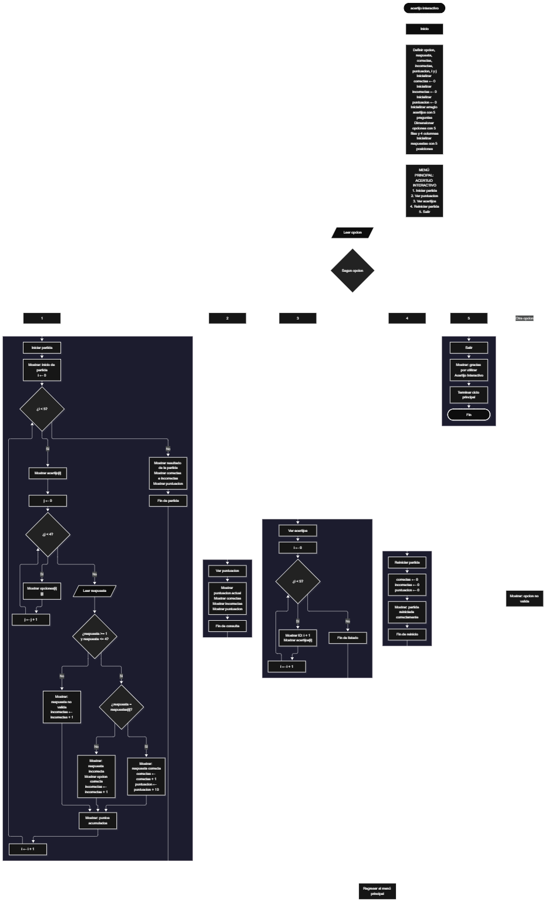

Este proyecto, llamado <b>Acertijo Interactivo</b>, fue desarrollado en <b>Java</b> como un ejercicio práctico para fortalecer la lógica de programación mediante la creación de un juego de preguntas y respuestas desde la consola. El programa cuenta con un menú principal de cinco opciones que permite <b>iniciar partidas, consultar la puntuación, visualizar los acertijos, reiniciar la partida y salir</b>. Cada partida contiene cinco acertijos, y cada uno presenta cuatro opciones de respuesta para que el usuario seleccione la que considere correcta. Para organizar la información, se utilizan arreglos unidimensionales y bidimensionales que almacenan los acertijos, las opciones disponibles y las respuestas correctas. Además, el programa incorpora un sistema de puntuación que otorga <b>10 puntos por cada respuesta correcta</b> y contabiliza las respuestas correctas e incorrectas. Durante su desarrollo se aplicaron conceptos fundamentales de programación, como variables, arreglos, estructuras condicionales, ciclos repetitivos y estructuras de selección. Este proyecto permite poner en práctica los conocimientos adquiridos en Java y sirve como base para desarrollar juegos interactivos más completos utilizando otros lenguajes y tecnologías.

<h2 align="center">⚙️ Funcionamiento del menú principal</h2>

### 🎮 Iniciar partida

La opción <b>1) iniciar partida</b> permite comenzar una ronda de acertijos. Al seleccionar esta opción, el programa utiliza un ciclo <b>for</b> para recorrer los cinco acertijos almacenados en el arreglo <b>acertijos</b>. En cada repetición, muestra el acertijo correspondiente y utiliza otro ciclo <b>for</b> para presentar sus cuatro opciones de respuesta almacenadas en el arreglo bidimensional <b>opciones</b>. Después, solicita al usuario que seleccione una respuesta y comprueba que el número introducido esté entre <b>1 y 4</b>. Si la selección es válida, compara la respuesta con el valor almacenado en el arreglo <b>respuestas</b>. Cuando la respuesta es correcta, muestra el mensaje <b>"respuesta correcta."</b>, aumenta la variable <b>correctas</b> en uno y suma <b>10 puntos</b> a la variable <b>puntuacion</b>. Si la respuesta es incorrecta, muestra el mensaje <b>"respuesta incorrecta."</b>, presenta cuál era la respuesta correcta y aumenta la variable <b>incorrectas</b> en uno. Si el número seleccionado está fuera del rango permitido, muestra el mensaje <b>"respuesta no valida."</b> y también incrementa el contador de respuestas incorrectas. Después de evaluar cada acertijo, muestra los puntos acumulados. Al finalizar los cinco acertijos, presenta el resultado de la partida con la cantidad de respuestas correctas, incorrectas y la puntuación obtenida.

### 🏆 Ver puntuación

La opción <b>2) ver puntuacion</b> permite consultar los resultados acumulados durante la ejecución del programa. Al seleccionarla, muestra los valores almacenados en las variables <b>correctas, incorrectas y puntuacion</b>. De esta manera, el usuario puede conocer cuántas respuestas ha contestado correctamente, cuántas han sido incorrectas y cuántos puntos ha conseguido. Los valores se mantienen acumulados cuando se inician nuevas partidas, por lo que esta opción permite consultar el resultado general hasta el momento en que se reinicie la partida.

### 📋 Ver acertijos

La opción <b>3) ver acertijos</b> permite consultar la lista completa de preguntas almacenadas en el programa. Para mostrar la información, utiliza un ciclo <b>for</b> que recorre el arreglo <b>acertijos</b> desde la primera posición hasta la última. Durante el recorrido, presenta el identificador de cada acertijo y su respectivo contenido. Esta funcionalidad permite visualizar los cinco acertijos disponibles sin iniciar una partida ni modificar la puntuación del usuario.

### 🔄 Reiniciar partida

La opción <b>4) reiniciar partida</b> permite restablecer los resultados acumulados durante la ejecución del programa. Al seleccionarla, asigna el valor <b>0</b> a las variables <b>correctas, incorrectas y puntuacion</b>. De esta manera, se eliminan los resultados acumulados de las partidas anteriores y el usuario puede comenzar nuevamente con sus contadores en cero. Finalmente, muestra el mensaje <b>"partida reiniciada correctamente."</b>. Esta operación no modifica los acertijos, las opciones de respuesta ni las respuestas correctas almacenadas en los arreglos.

### 🚪 Salir del menú principal

La opción <b>5) salir</b> permite finalizar la ejecución del programa. Al seleccionarla, muestra el mensaje <b>"gracias por utilizar Acertijo Interactivo."</b>. El menú principal se encuentra dentro de una estructura repetitiva <b>do-while</b>, que mantiene el programa en funcionamiento mientras la variable <b>opcion</b> sea diferente de <b>5</b>. Cuando el usuario selecciona esta opción, la condición del ciclo se cumple y el programa finaliza su ejecución. Finalmente, se utiliza la instrucción <b>entrada.close()</b> para cerrar el objeto Scanner utilizado para leer los datos ingresados por teclado.

<h2 align="center">🧠 Temas aplicados en el proyecto</h2>

### 📦 Variables

En este proyecto se utilizan variables para controlar la opción seleccionada en el menú, almacenar las respuestas introducidas por el usuario, contabilizar los resultados obtenidos y llevar el control de la puntuación. Cada variable cumple una función específica dentro del funcionamiento del juego, permitiendo evaluar las respuestas y presentar los resultados de cada partida.

🔢 **Opcion:** Almacena la opción seleccionada por el usuario en el menú principal.

🔎 **Respuesta:** Almacena el número de la opción seleccionada para responder cada acertijo.

✅ **Correctas:** Cuenta la cantidad de respuestas correctas.

❌ **Incorrectas:** Cuenta la cantidad de respuestas incorrectas.

🏆 **Puntuacion:** Almacena los puntos acumulados durante las partidas.

🔄 **I:** Funciona como contador en el ciclo que recorre los cinco acertijos.

🔁 **J:** Funciona como contador en el ciclo que recorre las cuatro opciones de cada acertijo.

### 🗃️ Arreglos

En este proyecto se utilizan tres arreglos para organizar la información correspondiente a los acertijos. Los arreglos unidimensionales permiten almacenar las preguntas y sus respuestas correctas, mientras que el arreglo bidimensional almacena las cuatro opciones disponibles para cada pregunta. La información se encuentra relacionada mediante los índices de los arreglos, de manera que cada acertijo tiene sus propias opciones y su respectiva respuesta correcta.

📝 **Acertijos[5]:** Almacena los cinco acertijos que se presentan durante las partidas.

📋 **Opciones[5][4]:** Es un arreglo bidimensional que almacena cuatro opciones de respuesta para cada uno de los cinco acertijos.

✅ **Respuestas[5]:** Almacena el número correspondiente a la opción correcta de cada acertijo. En este proyecto, todas las respuestas correctas se encuentran en la primera posición.

### 🔀 Estructuras condicionales

En este proyecto se utilizan las estructuras <b>if-else</b> para comprobar si la respuesta introducida por el usuario se encuentra dentro del rango permitido y determinar si coincide con la respuesta correcta almacenada en el arreglo <b>respuestas</b>. También permiten diferenciar entre respuestas correctas, incorrectas y selecciones no válidas. Estas condiciones hacen posible que el programa ejecute diferentes instrucciones dependiendo del resultado de cada evaluación.

### 🔄 Estructuras repetitivas

En este proyecto se utilizan los ciclos <b>for</b> y <b>do-while</b>. Los ciclos <b>for</b> permiten recorrer el arreglo de acertijos y mostrar las opciones correspondientes a cada pregunta. Por otro lado, el ciclo <b>do-while</b> mantiene activo el menú principal para que el usuario pueda seleccionar diferentes funcionalidades. De esta manera, el programa puede ejecutar varias operaciones y repetir partidas hasta que se seleccione la opción de salida.

### 🎯 Estructura switch-case

El programa utiliza la estructura <b>switch-case</b> para evaluar el valor almacenado en la variable <b>opcion</b> y ejecutar la funcionalidad correspondiente del menú principal. Cada caso representa una operación específica del juego: <b>iniciar partida, ver puntuación, ver acertijos, reiniciar partida o salir</b>. También se utiliza el bloque <b>default</b> para mostrar el mensaje <b>"opcion no valida."</b> cuando el usuario introduce un número que no corresponde a ninguna de las opciones definidas.

### 🔢 Evaluación de respuestas

El programa utiliza el arreglo <b>respuestas</b> para identificar cuál es la opción correcta de cada acertijo. Durante una partida, compara el número seleccionado por el usuario con el valor almacenado en la posición correspondiente del arreglo. Si ambos valores coinciden, se registra una respuesta correcta y se suman diez puntos. En caso contrario, se contabiliza una respuesta incorrecta y se muestra el contenido de la opción correcta utilizando el arreglo bidimensional <b>opciones</b>.

### 🏆 Sistema de puntuación

El sistema de puntuación permite llevar el control de los puntos obtenidos durante las partidas. Cada vez que el usuario responde correctamente un acertijo, la variable <b>puntuacion</b> aumenta en <b>10 puntos</b>. Al mismo tiempo, la variable <b>correctas</b> incrementa su valor en uno. Cuando la respuesta es incorrecta o no se encuentra dentro del rango permitido, aumenta la variable <b>incorrectas</b>. Los resultados se mantienen acumulados durante la ejecución del programa y únicamente vuelven a cero cuando se selecciona la opción <b>4) reiniciar partida</b>.

<h2 align="center">Diagrama de flujo del proyecto</h2>

<h2 align="center">🛡️ Validaciones del programa</h2>

### 🔢 Selección de respuesta

Esta validación se utiliza durante la resolución de cada acertijo. El programa comprueba que el número introducido por el usuario se encuentre entre <b>1 y 4</b>, mediante la condición <b>respuesta &gt;= 1 && respuesta &lt;= 4</b>. Si el valor se encuentra dentro del rango permitido, continúa con la comparación para determinar si la respuesta es correcta o incorrecta. En caso contrario, muestra el mensaje <b>"respuesta no valida."</b> e incrementa el contador de respuestas incorrectas.

### ❌ Respuesta incorrecta

Esta validación permite identificar cuando el usuario selecciona una opción que no coincide con la respuesta correcta del acertijo. El programa compara el valor introducido con el contenido almacenado en el arreglo <b>respuestas</b>. Si ambos valores son diferentes, muestra el mensaje <b>"respuesta incorrecta."</b>, presenta la opción correcta y aumenta la variable <b>incorrectas</b> en uno. Esta comprobación permite llevar un registro de los errores cometidos durante las partidas.

### ⚠️ Opción inválida del menú

La estructura <b>switch-case</b> incluye el bloque <b>default</b>, que se ejecuta cuando el usuario introduce un número que no corresponde a ninguna de las cinco opciones disponibles. En ese caso, el programa muestra el mensaje <b>"opcion no valida."</b> y vuelve a presentar el menú principal, debido a que el ciclo <b>do-while</b> continúa activo mientras no se seleccione la opción <b>5</b>.

### 🔄 Reinicio de puntuación

Esta validación corresponde a la opción de reiniciar partida. El programa restablece las variables <b>correctas, incorrectas y puntuacion</b> a cero para comenzar nuevamente el registro de resultados. Los arreglos que contienen los acertijos, las opciones y las respuestas correctas permanecen sin modificaciones, ya que el reinicio solamente afecta los contadores y la puntuación acumulada.

### 🔁 Finalización del programa

El ciclo <b>do-while</b> utiliza la condición <b>opcion != 5</b> para mantener el menú principal en funcionamiento. Cuando el usuario selecciona la opción <b>5</b>, el ciclo termina y el programa ejecuta la instrucción <b>entrada.close()</b> para cerrar el objeto Scanner. Esta condición permite finalizar correctamente la ejecución del juego mediante la opción de salida.

<h2 align="center">🎯 Objetivo del proyecto</h2>

El objetivo principal de este proyecto es fortalecer la <b>lógica de programación</b> mediante el desarrollo de un juego interactivo de acertijos en <b>Java</b>. A través de su construcción se busca aplicar los conocimientos adquiridos sobre variables, arreglos unidimensionales y bidimensionales, estructuras condicionales, ciclos repetitivos y estructuras de selección, integrándolos para desarrollar un sistema de preguntas y respuestas. Además, el proyecto permite comprender cómo organizar información mediante arreglos, evaluar respuestas ingresadas por el usuario, controlar resultados y gestionar una puntuación acumulativa en una aplicación de consola, estableciendo una base para desarrollar juegos más completos con otros lenguajes y tecnologías.

